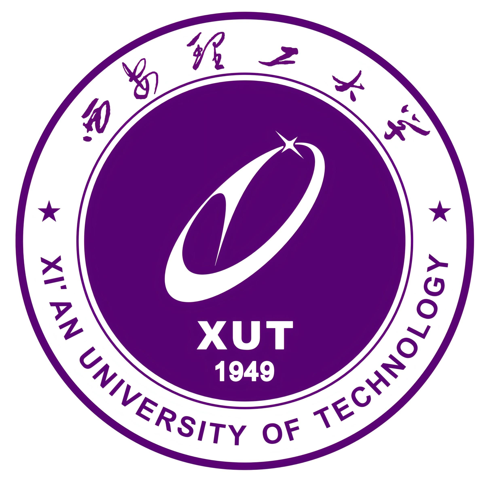
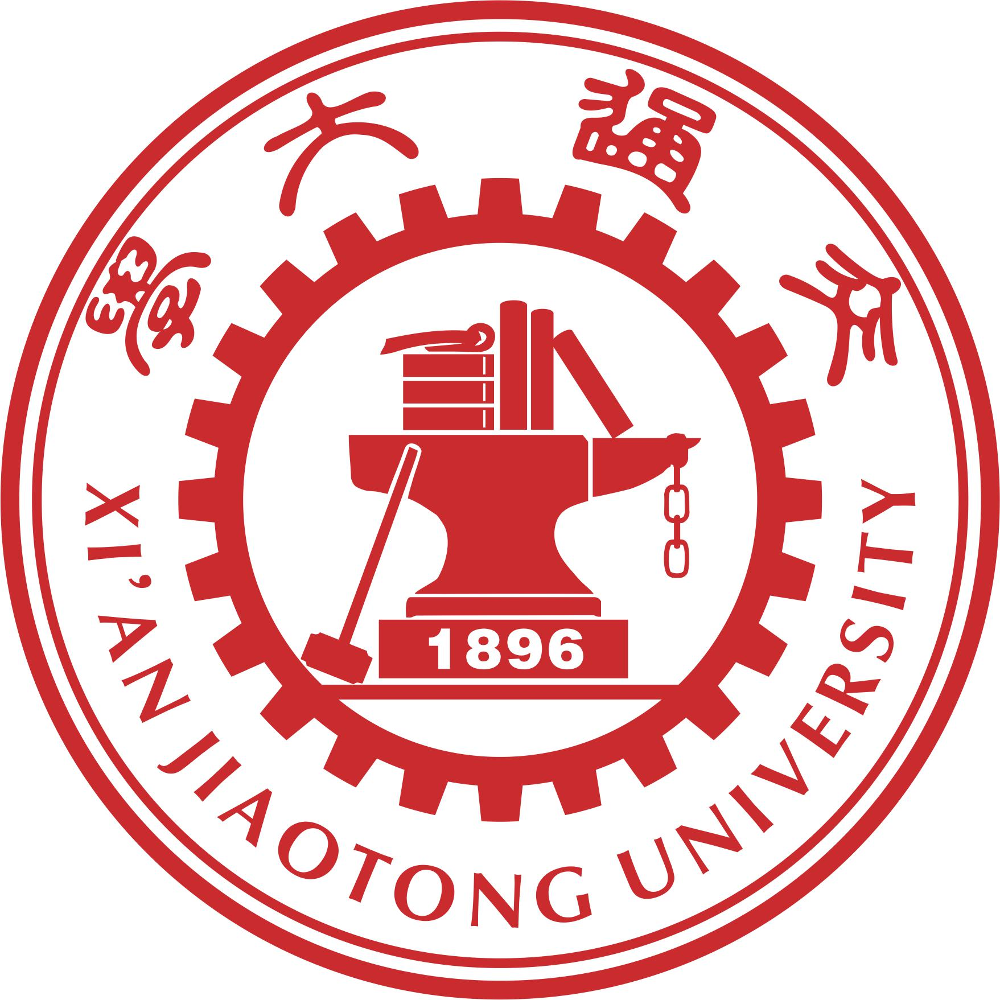

<!--
  本仓库即主页 README：github.com/0130zky/0130zky
  assets/ 目录里放着三个 logo，改字不用动图。
-->

<h1 align="center">你好 👋，我是张凯越</h1>

<i>请在白日梦尽头等我</i>

  

---

### 🧢 关于我

- 🎓 **本科在读** · 西安理工大学 · 电子科学与技术（2029毕业）
- 🔬 **科研经历** · 西安交通大学 · 精密微纳制造技术全国重点实验室
- 🤖 **RoboMaster 战队** · 27赛季电控组组长，电机三环控制、CAN 总线、STM32
- 💼 **实习经历** · 影石创新 Insta360（2026.05 – 2026.10），嵌入式软件测试开发实习生

---

### 🏫 与我有关

  
  &nbsp;&nbsp;&nbsp;
  
  &nbsp;&nbsp;&nbsp;
  
  &nbsp;&nbsp;&nbsp;
  

---

### 🛠 技术栈

  

- **语言：** C / C++ · Python ·  Rust · Java
- **MCU / 总线：** STM32F1 / F4 / H7，HAL 库，CAN、UART、SPI、I2C
- **运动控制：** 电机三环控制，DM3507 / GM6020 / M3508，offboard 调参；PX4，AP与无人机控制算法（避障与路径规划方向）
- **硬件：** PCB Layout（嘉立创 EDA）、原理图 review、焊接
- **工具链：** Keil、STM32CubeMX、OpenOCD / DAPLink、Git、Docker、Ubuntu
- **桌面 / Web：** React + TypeScript、Tauri、FastAPI、Nginx

---

### 📫 联系我

- 📧 **邮箱：** kaiyue.link@gmail.com
